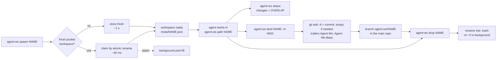
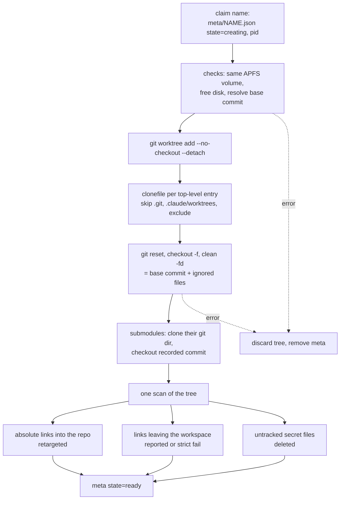
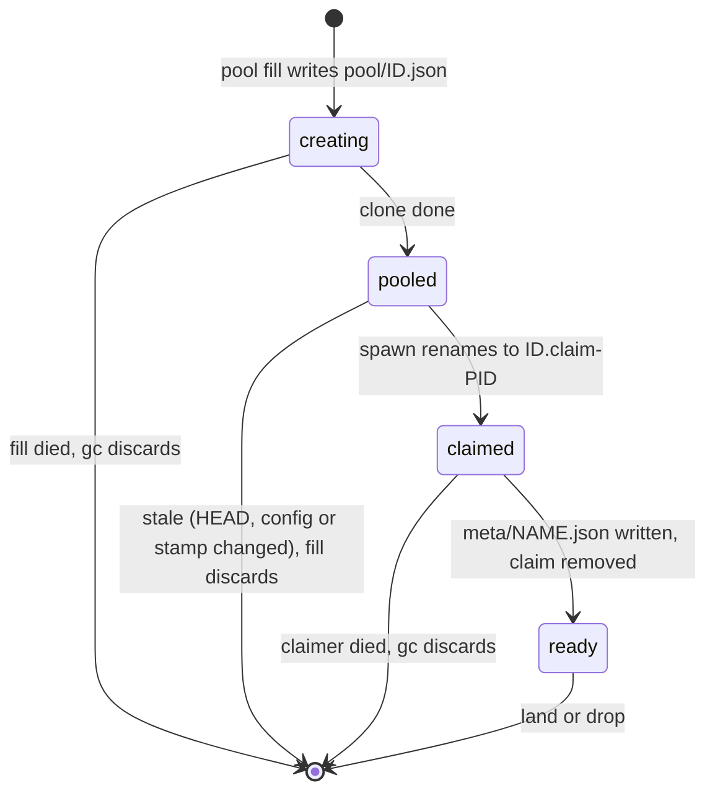

# agent-ws

Instant, isolated workspaces for coding agents on macOS (APFS).

A workspace is a Git worktree whose files are APFS clones of your checkout,
ignored files included. Agents start with `node_modules` and build caches in
place, so there is no `install` step, and the clones share disk blocks until
something is written.

```sh
agent-ws pool set 4               # keep 4 workspaces ready (optional)
agent-ws spawn a1                 # ~40 ms from the pool, ~1 s cloning fresh
cd "$(agent-ws path a1)"          # work there
agent-ws status                   # changed files per workspace + OVERLAP warnings
agent-ws land a1 -m "feat: ..."   # commit to branch agent-ws/a1, remove workspace
agent-ws drop a1                  # remove without landing (instant)
agent-ws list
agent-ws gc                       # clean up after crashes (--dry-run to preview)
```

Every command accepts `--json`. Timings are from a 2.7k-file repository with
700 npm packages (see [Benchmarks](#benchmarks)).

## Benchmarks

Apple M4 (10 cores, 16 GB), macOS 26.6, APFS, git 2.39. Repository: a private
TypeScript monorepo with 2,693 tracked files and 26,411 files in `node_modules`
(pnpm). Each cell is the range over two runs of `bench/bench.sh`, each value
the median of 3 tries.

| Step | `git worktree` | agent-ws |
| --- | --- | --- |
| New workspace, ready to build | 2.5 – 4.8 s (add + `pnpm install`) | 1.16 – 1.38 s (fresh clone) |
| New workspace from the pool | — | 41 – 43 ms |
| 8 new workspaces at once (wall time) | — | 4.6 – 5.1 s fresh, 75 – 81 ms from the pool |
| Remove a workspace | 2.2 – 2.8 s (`worktree remove`) | 33 – 36 ms (`drop`) |
| Disk per workspace | full copy of tracked files and deps | 13 – 15 MB real (820 MB logical) |

Notes:

- The install ran with a warm pnpm store, `--offline` and `--ignore-scripts`,
  the best case for `git worktree`; a cold store or postinstall scripts make
  it much slower.
- `drop` returns at once; the tree is deleted in the background.
- Disk is measured as the drop in free space after 5 fresh workspaces; `du`
  shows the logical size because clones share blocks.
- The first build or typecheck in a new workspace still reads files cold.

Reproduce on a throwaway APFS copy of your repository:

```sh
cp -c -R my-repo /tmp/my-repo-copy        # same volume as your home folder
bench/bench.sh /tmp/my-repo-copy "pnpm install --frozen-lockfile --offline"
```

## How it works

Lifecycle of one workspace:



What a fresh clone does:



Pool records and who may touch them:



## What a workspace contains

- Tracked files at the base commit (`--base`, default `HEAD`). Uncommitted
  edits and untracked files in your checkout are not copied.
- Ignored files from your checkout (dependencies, caches, build output).
- Not `.git` (the worktree links to the shared object store) and not
  `.claude/worktrees`. Skip more with `--exclude PATH` or `exclude` in the
  config.
- Not untracked secret files, wherever they are (also inside ignored
  folders): `.env`, `.env.*`, `.dev.vars`, `*.pem`, `*.key`, `*.p12`,
  `id_rsa`, `id_ed25519`, except `.env.example`, `.env.sample` and
  `.env.template`. Tracked files are never removed. Every removed secret is
  listed in the spawn output. `--keep-secrets` keeps them, including untracked
  secrets that are not ignored (other untracked files are still left out).
- Checked-out submodules with their own copy of the submodule's git dir, at
  the commit the base records. Commits made inside a submodule stay in the
  workspace; `land` records the new submodule commit in the parent.

## Pool

`agent-ws pool set N` keeps N workspaces ready. A spawn takes one with an
atomic rename (8 parallel spawns: 80 ms wall time, ~40 ms each) and starts a
background `pool fill` to replace it. Without a pool, parallel spawns contend
for the disk (8 at once: ~5 s).

A pooled workspace is used only while it still matches: same `HEAD`, same
config, and unchanged lockfiles and `node_modules` stamp files
(`pool_stamp`). Spawns with `--base`, `--exclude` or `--keep-secrets`, or
`--no-pool`, always clone fresh. `pool status` shows fresh and stale entries,
`pool fill` replaces stale ones now, `pool clear` empties the pool.

The first build or typecheck in any new workspace reads files cold (the page
cache is per file, not per disk block), so it is slower than in your checkout;
later runs are warm.

## Configuration

Optional `.agent-ws.toml` at the repository root:

```toml
exclude = ["tmp/huge"]          # never cloned
secrets = [".env", "*.pem"]     # replaces the default secret patterns
secrets_keep = [".env.example"] # replaces the default exceptions
strict_symlinks = true          # fail a spawn on symlinks leaving the workspace
min_free_gb = 5                 # default 2
pool = 4                        # default pool size; `pool set` overrides it
pool_stamp = ["pnpm-lock.yaml"] # files whose change makes the pool stale
```

Unknown keys are an error.

## Safety

- Writes in a workspace never change your checkout (copy-on-write).
- Absolute symlinks into your checkout are retargeted into the workspace.
  Relative symlinks that climb out of the repository are rewritten to the
  absolute path they meant in your checkout. Both kinds of links that leave
  the workspace are reported, and fail the spawn with `strict_symlinks`.
- `land` always adds a commit carrying the message and the `Agent-Ws`
  trailers (empty if the agent already committed everything). It refuses to
  overwrite an existing branch (`--branch NAME` or `--force-branch`), except
  that a branch already at the workspace's HEAD finishes an interrupted land,
  and a branch this workspace landed earlier (`land --keep`) moves forward.
  It keeps the workspace when it fails and reports files other workspaces
  also changed. Changed files count every path touched: a rename is two.
- `drop` renames the tree into `.trash` and deletes it in the background.
- Records are plain JSON files, so nothing trusts them blindly: a record
  whose path is not a workspace folder (`<home>/<repo>/ws/<name>`) is
  reported as corrupt and never renamed, deleted or used for git commands;
  `gc` forgets such records without touching the path.
- Spawning stops below 2 GB of free disk.

## Many agents at once

- Spawn, land, drop and pool fills are safe to run in parallel. A spawn
  claims its name first, so two agents asking for the same name get exactly
  one workspace, and a pooled workspace is never handed out twice.
- `gc` removes spawns and pool fills whose process died, records of folders
  deleted by hand, dead pool claims, folders with no record and trash older
  than 10 minutes, and forgets corrupt records. It never touches work whose
  process is still alive; records store the process start time, so another
  process that later got the same pid does not count as alive.

## Storage

State and workspaces live in `~/.agent-ws/<repo>-<hash>/` (override with
`AGENT_WS_HOME`; it must be on the same APFS volume as the repository). The
folder is excluded from Spotlight and Time Machine.

## Library

All logic is in the `agent_ws` library (`Repo::spawn`, `status`, `land`,
`drop`, `gc`, `pool_fill`) so other tools can embed it; `src/main.rs` is a
thin CLI.
