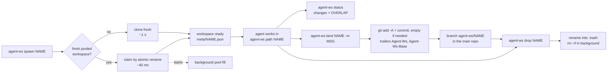
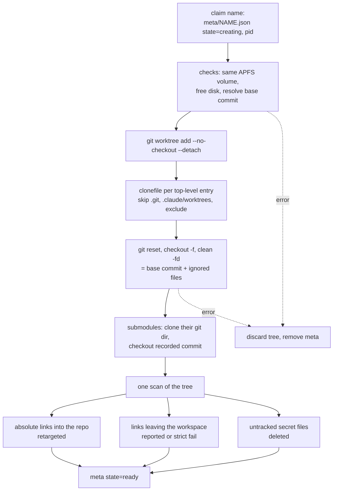
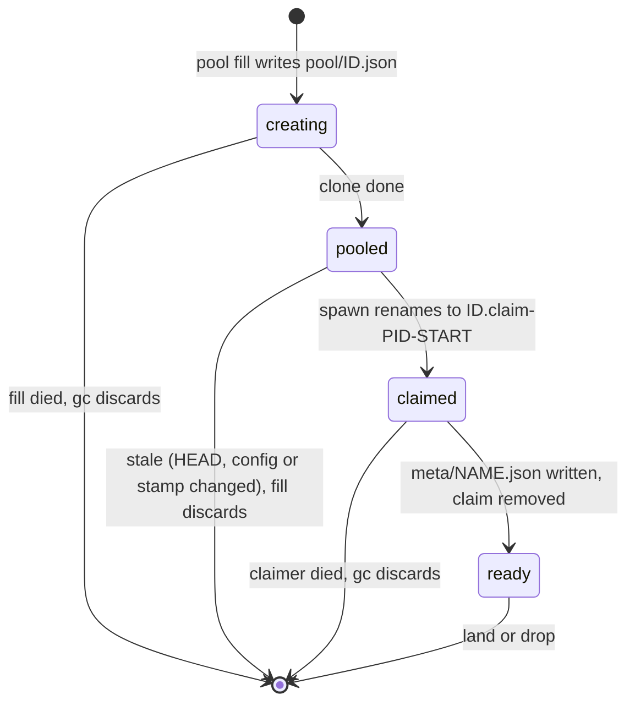
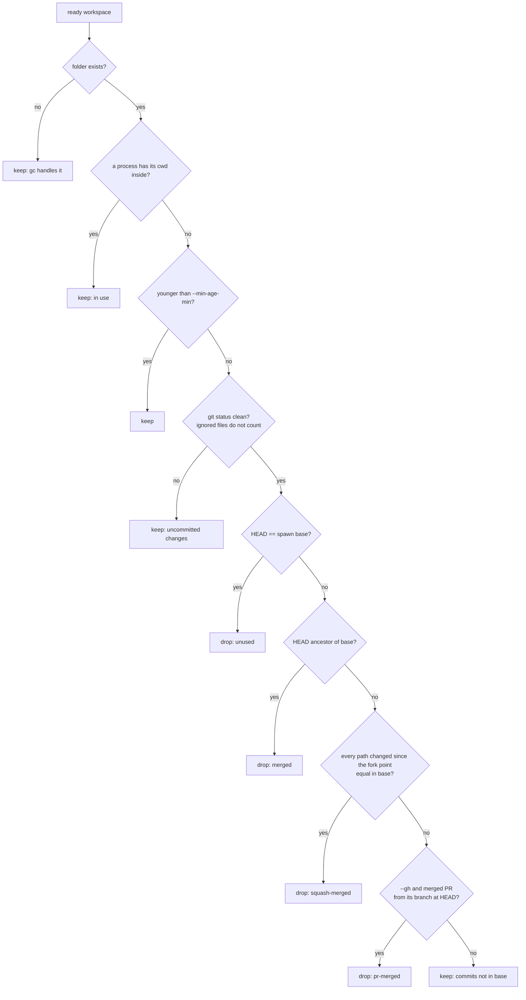

# How agent-ws works

This page is for people who want to understand or change agent-ws. To use it,
read the [README](../README.md).

## Lifecycle of one workspace



## What a fresh clone does



`clonefile(2)` on a directory clones the whole tree in one system call. Data
blocks are shared copy-on-write, so a clone costs metadata only; a file is
copied block by block only when something writes to it.

## What a workspace contains

- Tracked files at the base commit (`--base`, default `HEAD`). Uncommitted
  edits and untracked files in the source checkout are not copied.
- Ignored files from the source checkout (dependencies, caches, build output).
- Not `.git` (the worktree links to the shared object store) and not
  `.claude/worktrees`. More paths can be skipped with `--exclude` or the
  `exclude` setting.
- Not untracked secret files, wherever they are (also inside ignored
  folders): `.env`, `.env.*`, `.dev.vars`, `*.pem`, `*.key`, `*.p12`,
  `id_rsa`, `id_ed25519`, except `.env.example`, `.env.sample` and
  `.env.template`. Tracked files are never removed. `--keep-secrets` keeps
  them, including untracked secrets that are not ignored; other untracked
  files are still left out.
- Checked-out submodules with their own copy of the submodule's git dir, at
  the commit the base records. Commits made inside a submodule stay in the
  workspace; `land` records the new submodule commit in the parent.

## Pool

Pooled workspaces are ordinary fresh clones registered under `pool/` instead
of `meta/`. A spawn takes one by renaming its record (atomic, so of several
racing spawns exactly one wins), then writes the named record.



A pooled workspace is used only while its freshness key matches: `HEAD`, the
settings that shape a workspace, and the size and mtime of the stamp files
(lockfiles, `node_modules/.modules.yaml` …). Edits to other ignored files are
not detected, so a pooled workspace can carry slightly older dependencies if
they changed without touching a stamp file. Only one `pool fill` runs at a
time (`flock`).

The first build in any new workspace reads files cold: macOS caches file
contents per file, not per shared disk block.

## Safety

- Writes in a workspace never change the source checkout (copy-on-write).
- Absolute symlinks into the source are retargeted into the workspace.
  Relative symlinks that climb out of the repository are rewritten to the
  absolute path they meant in the source. Both kinds of links that leave the
  workspace are reported, and fail the spawn with `strict_symlinks`.
- Records are plain JSON files, so nothing trusts them: a record whose path is
  not exactly `<home>/<repo>/ws/<name>` is corrupt and is never renamed,
  deleted or used for git commands; `gc` forgets it without touching the
  path. Every removal goes through one function that checks this.
- `land` always adds a commit carrying the message and the `Agent-Ws`
  trailers (empty if the agent already committed everything). It refuses an
  existing branch unless the branch is already at the workspace's HEAD (an
  interrupted land) or was landed earlier by the same workspace (`--keep`),
  which then moves forward. Changed files count every path touched: a rename
  is two, so deleting a file another workspace edits is an overlap.
- `drop` renames the tree into `.trash` and deletes it with a background
  `rm -rf` in its own process group, so closing the terminal does not stop
  it. Each `drop` restarts deletes older than 10 minutes.
- Spawning stops below 2 GB of free disk (configurable) and warns below
  10 GB or from 20 workspaces (`warn_workspaces`).
- The pool holds at most 8 workspaces.

## Disk use and prune

A cloned block belongs to every file that shares it, so `du` counts it once
per workspace. `agent-ws du` asks APFS instead: `getattrlist` with
`ATTR_CMNEXT_PRIVATESIZE` gives the bytes of a file that no other file
shares, which is what deleting it frees. Workspaces are walked in parallel,
one thread per core. Data not yet flushed has no blocks yet and counts later.
Blocks shared by two workspaces but no longer by the source are private to
neither, so the sum is a lower bound for a group.

`prune` checks each ready workspace, cheapest test first:



All checks are read-only (`git --no-optional-locks status`, `merge-base`,
`diff`), so `--dry-run` writes nothing, not even the index. A branch whose
upstream is gone is not enough on its own: a closed, unmerged PR deletes its
branch too. Dropping goes through `drop`.

The current directories come from `proc_pidinfo(PROC_PIDVNODEPATHINFO)` for
every process of the user.

## Many agents at once

- Spawn, land, drop and pool fills are safe in parallel. A spawn claims its
  name with an exclusive create before any work, so same-name spawns have
  exactly one winner.
- Records of work in progress store the pid and the process start time.
  `gc` removes spawns, pool fills and pool claims whose process died
  (a later process that got the same pid does not count as alive), records of
  folders deleted by hand, folders with no record, and trash older than
  10 minutes. It never touches work whose process is still alive.

## Storage

State and workspaces live in `~/.agent-ws/<repo>-<hash>/`:

```
meta/<name>.json     named workspaces
pool/<id>.json       pooled workspaces (id = @pool-<nanos>)
ws/<name or id>/     the workspace trees (Git worktrees)
.trash/              trees being deleted in the background
pool.json, pool.lock pool target and fill lock
```

`AGENT_WS_HOME` overrides `~/.agent-ws`; it must be on the same APFS volume as
the repository. The folder is excluded from Spotlight and Time Machine.

## Code map

| File | Role |
| --- | --- |
| `src/lib.rs` | `Repo`: spawn, claim, create/fill, pool, gc, prune, du, status, land, drop |
| `src/fsutil.rs` | `clonefile` FFI, tree clone, free space, private size, cwd users, the workspace scan, glob |
| `src/git.rs` | `git` CLI wrapper and changed-path listing |
| `src/config.rs` | `.agent-ws.toml` |
| `src/main.rs` | thin CLI (clap) and background refill |
| `tests/cli.rs` | end-to-end tests on throwaway repositories |
| `bench/bench.sh` | benchmark against `git worktree` |

All logic lives in the library so other tools can embed it.
