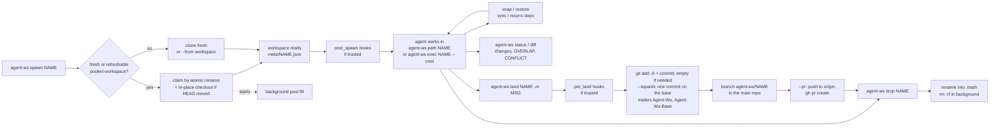
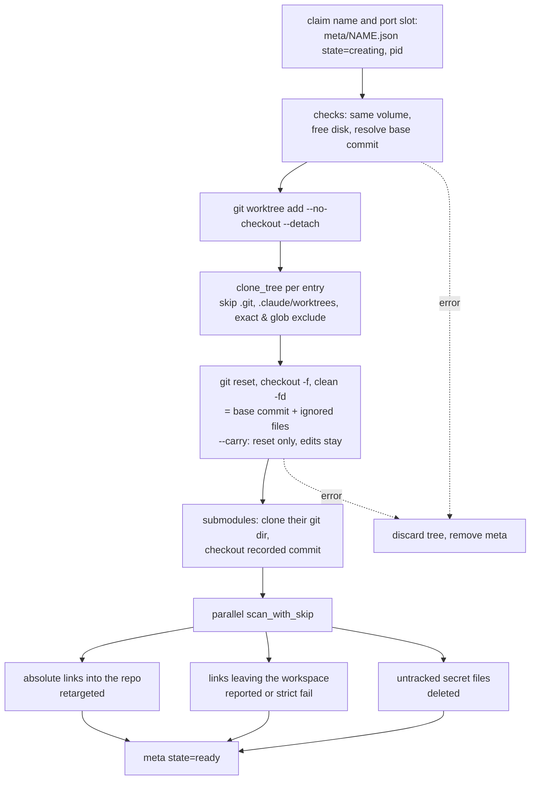
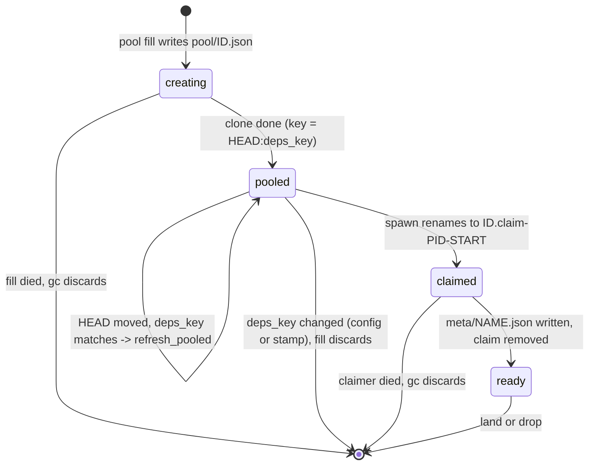
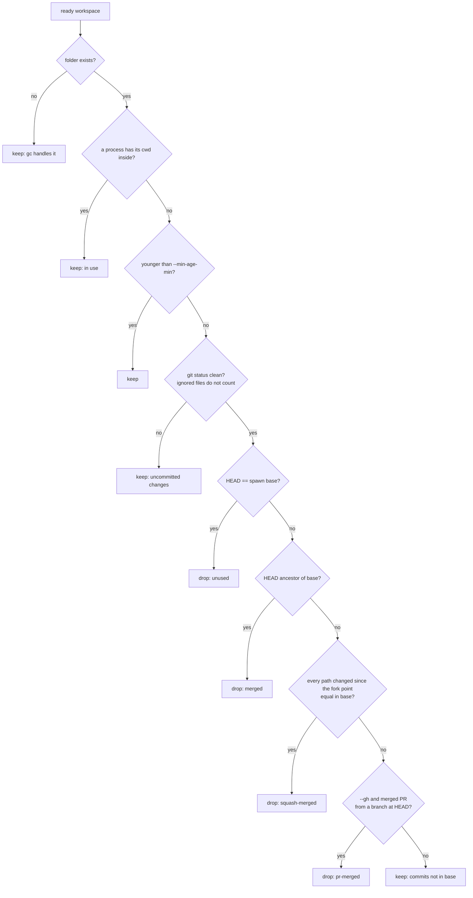

# How agent-ws works

This page is for people who want to understand or change agent-ws. To use it,
read the [README](../README.md).

## Lifecycle of one workspace



## What a fresh clone does



`clonefile(2)` on a directory clones the whole tree in one system call on
macOS. Data blocks are shared copy-on-write, so a clone costs metadata only; a
file is copied block by block only when something writes to it.

`exclude` accepts both exact relative paths (`tmp/huge`) and path globs (`*`,
`?`, `**` such as `**/node_modules`, `apps/*/dist`, `*.log`). `clone_tree`
normalizes excludes and evaluates `may_match_under` before descending into a
directory: directories that cannot contain any excluded path are still cloned in
a single `clonefile(2)` call on macOS, while directories that may match are
recreated and traversed entry by entry.

Linux has no directory clone. There `clone_path` walks the tree iteratively,
recreates directories, and batches regular files across up to
`available_parallelism()` worker threads (`std::thread::scope`) to reflink each
file with the `FICLONE` ioctl, which shares data blocks the same way on Btrfs
and on XFS (`reflink=1`, the default since xfsprogs 5.1). Modes and timestamps
are kept (applied deepest-first on directories after children are created), so
build tools see unchanged files. On a filesystem without reflinks (ext4) the
spawn fails with `UNSUPPORTED_FS`.

After cloning and Git checkout, `scan_with_skip` runs in parallel across
top-level subdirectories (`std::thread::scope`), pruning any subtree matching
`scan_skip` globs so huge build/dependency folders (`target`, `**/node_modules`)
do not have to be walked for secrets or symlinks.

After the scan, `--branch` creates and checks out a branch at the base, then
the trusted `post_spawn` hooks run. If either fails, the workspace is dropped
again, so a spawn either fully happens or leaves nothing.

### Forking from a workspace (`spawn --from`)

`spawn --from SRC` creates a new detached worktree at `SRC`'s `HEAD`, runs
`clone_tree` from `SRC`'s folder (bringing uncommitted edits, untracked files,
and caches), CoW-copies `SRC`'s Git index file so staged changes survive,
isolates any submodules, runs `scan_with_skip`, and records `SRC`'s original
`base` commit so `status`, `diff`, and `land` still measure the full divergence
from the base.

## What a workspace contains

- Tracked files at the base commit (`--base`, default `HEAD`). Uncommitted
  edits and untracked files in the source checkout are not copied, unless
  `--carry` brings them: then the base must be `HEAD`, the clone keeps the
  working tree as it is (only the index is reset to `HEAD`), and the edits
  show up as uncommitted changes. Submodules keep their state too. Secrets
  still stay behind without `--keep-secrets`, and the pool is not used.
- Ignored files from the source checkout (dependencies, caches, build output).
- Not `.git` (the worktree links to the shared object store) and not
  `.claude/worktrees`. More paths or globs can be skipped with `--exclude` or
  the `exclude` setting.
- Not untracked secret files, wherever they are (unless inside a `scan_skip`
  directory): `.env`, `.env.*`, `.dev.vars`, `*.pem`, `*.key`, `*.p12`, `id_rsa`,
  `id_ed25519`, except `.env.example`, `.env.sample` and `.env.template`. Tracked
  files are never removed. Files holding only PEM certificates (no key), such
  as certifi's `cacert.pem` CA bundle in a Python `.venv`, are public and stay.
  `--keep-secrets` keeps them, including untracked secrets that are not ignored;
  other untracked files are still left out.
- Checked-out submodules with their own copy of the submodule's git dir, at
  the commit the base records. Commits made inside a submodule stay in the
  workspace; `land` records the new submodule commit in the parent.

## Pool (with Incremental Pool Refresh)

Pooled workspaces are ordinary fresh clones registered under `pool/` instead
of `meta/`. A spawn takes one by renaming its record (atomic, so of several
racing spawns exactly one wins), then writes the named record.



A pooled workspace's freshness key is `<HEAD>:<deps_key>`, where `deps_key`
hashes the workspace-shaping config (`exclude`, `secrets`, `secrets_keep`,
`strict_symlinks`, `scan_skip`) and the `(mtime, mtime_nsec, size)` of every
stamp file (lockfiles, `node_modules/.modules.yaml`, …).

- **Fresh (`m.key == "<HEAD>:<deps_key>"`)**: claimed immediately via atomic
  rename (~40 ms).
- **Refreshable (`HEAD` moved, `deps_key` still matches)**: instead of throwing
  away a 1 GB clone on every commit, `claim()` (after exact matches) and
  `pool fill` run `refresh_pooled`, which executes `git checkout -q -f --detach
  <head>`, `git clean -fdq`, and refreshes submodules in place while keeping all
  shared CoW dependencies intact. `pool status` counts these under `refreshable`,
  and `pool fill` reports how many it `refreshed`.
- **Stale (`deps_key` changed)**: discarded and replaced by `pool fill`.

Only one `pool fill` runs at a time (`flock` on `pool.lock`).

The first build in any new workspace reads files cold: macOS caches file
contents per file, not per shared disk block.

## Ports and exec

Every named workspace gets a port slot when it is spawned: the lowest number
no other record holds, chosen under `slots.lock` so parallel spawns differ.
Dropping the workspace frees the slot. Commands that `exec` and the hooks
run get:

| Variable | Value |
| --- | --- |
| `AGENT_WS_NAME`, `AGENT_WS_PATH`, `AGENT_WS_BASE`, `AGENT_WS_REPO` | the workspace and its repository |
| `AGENT_WS_SLOT` | the slot |
| `PORT`, `AGENT_WS_PORT` | `port_base + slot * port_step`, by default 4100, 4110, 4120 … |

The default range stays clear of the usual dev server ports (3000, 4321,
5173, 8787); each workspace owns `port_step` ports from its `PORT` on.

`exec` starts the command in the workspace, then ignores Ctrl-C itself so
that it outlives the command: the signal still reaches the command, and
agent-ws records how it ended in `runs/<name>.json` (command, pid, start
time, end time, exit code; 128 + the signal for a killed command). `list
--long` reads that record: `running` while the pid with that start time
lives, `exited`, or `interrupted` when agent-ws itself was killed first.
The exit code of `agent-ws exec` is the command's.

## Reviewing work: diff and conflicts

`diff` and the conflict check need the workspace's current state as a tree,
uncommitted edits and new files included, without disturbing an agent that
may be committing at that moment:

- **Clean-tree fast-path**: if `is_dirty` is false, `snapshot()` uses
  `HEAD^{tree}` directly and `conflicts()` uses `HEAD` directly without copying
  the index or writing a temporary commit.
- **Dirty workspaces**: agent-ws copies the workspace's index to `tmp/`, runs
  `git add -A` and `git write-tree` with `GIT_INDEX_FILE` pointing at the copy,
  and deletes the copy. The copy keeps the cached file stats, so only changed
  files are read again; Git writes an index by rename, so the copy is never
  half-written. `diff` then compares the base with that tree.

`status` computes changed paths and dirty state in a single `git status
--porcelain=v1 -z` + `git diff --name-only -z` pass (`changed_paths_status`)
across workspaces in parallel. Paths changed in more than one workspace are
listed as `OVERLAP`. For each overlapping pair, `conflicts()` snapshots any
dirty workspaces in parallel (`std::thread::scope`), creates deterministic
snapshot commits on their `HEAD`s, and merges pairs in parallel using `git
merge-tree --write-tree` (Git 2.38+). Pairs that do not merge cleanly are
listed as `CONFLICT` with their paths. These commits use a fixed author and
date: the same content gives the same objects, so polling `status` adds nothing
to the repository once nothing changes.

## Checkpoints (`snap`, `snaps`, `restore`)

Snapshots give an agent or coordinator instant, repeatable CoW rollback points:

1. `snap` reads `HEAD`, clones the workspace directory (excluding `.git`) into a
   staging folder in `tmp/` using `clone_tree`, CoW-copies the worktree's Git
   `index` file, writes `snap.json` (`name`, `workspace`, `head`, `base`,
   `created`), and atomically renames the staging folder into
   `snaps/<ws>/<snap>/`.
2. `restore` clones `snaps/<ws>/<snap>/tree` into a staging folder in `tmp/`,
   copies the workspace's existing regular `.git` worktree file into staging,
   atomically renames the current workspace into `.trash` (for background
   `rm -rf`) and moves staging into `ws/<ws>`, restores the Git `index` (or
   removes it if the snapshot had none), resets `HEAD` with `git update-ref
   --no-deref HEAD <snap.head>`, and updates `meta/<ws>.json` if `base` changed.
3. Because `restore` clones from `snaps/<ws>/<snap>/tree` without consuming it,
   restoring to the same checkpoint is repeatable. `snap --drop`, `drop`, and
   `gc` move deleted snapshot trees into `.trash` for background cleanup.

## Sync and dependency resync (`sync`, `resync-deps`)

- `sync`: verifies the workspace working tree is clean (`DIRTY` otherwise),
  resolves the target `--base` (default: repository `HEAD`), and runs `git
  rebase <base>` (or `git merge --no-edit <base>` with `--merge`). If a
  conflict occurs, `sync` runs `--abort` so the workspace stays untouched and
  returns `CONFLICT`. On success it updates `meta.base` (and runs `resync-deps`
  when `--resync-deps` is passed).
- `resync-deps`: refreshes git-ignored dependency directories in an existing
  workspace from `self.root` (auto-detecting `node_modules`, `.venv`, `venv`,
  `target`, `.next`, `.turbo`, `.nuxt`, `vendor`, `dist`, `build`, or using
  explicit relative paths). Each target is verified to be git-ignored and not a
  symlink, CoW-cloned into `tmp/`, scanned for secrets with `scan_with_skip`,
  and atomically swapped into place while moving the old directory into
  `.trash` for background deletion.

## Hooks and trust

`[hooks]` in `.agent-ws.toml` holds shell commands: `post_spawn` runs in a new
workspace (pooled ones too), `pre_land` before `land` commits. They run with
the environment above, and their output goes to stderr, so `--json` output
and the path printed for Claude Code stay clean.

`.agent-ws.toml` comes with the repository, so a fresh clone could otherwise
make `spawn` run any command. Hooks run only after `agent-ws trust`, which
stores the exact set of commands in `trusted-hooks.json` in the repository's
state folder; any change to them needs `trust` again. A spawn or land that
would run untrusted hooks stops and lists them (`UNTRUSTED_HOOKS`). `spawn
--no-hooks` and `land --no-verify` skip them.

## Claude Code worktrees

Claude Code creates a git worktree for `claude --worktree`, for subagents
with `isolation: "worktree"`, for workflows and for background sessions. Its
`WorktreeCreate` and `WorktreeRemove` hooks replace that, and `agent-ws claude
install` registers `agent-ws claude hook` for both in a settings file
(`.claude/settings.local.json` by default), keeping everything else in the
file, key order included. Settings reads and writes reject symlinks and update
atomically via temp file + `sync_all` + `rename`.

- `WorktreeCreate` reads Claude's JSON on stdin (capped at 1 MiB) and spawns a
  workspace named after the worktree (`-2`, `-3` … when taken), from the pool
  when one is ready, on a new branch `agent-ws/<name>`, with `origin: claude`
  in its record. It prints the path and nothing else on stdout; warnings and
  hook output go to stderr.
- Commits the session makes land on that branch, which outlives the
  workspace like the branch of a git worktree. `WorktreeRemove` drops the
  workspace; the branch stays if it has commits and is deleted if it never
  moved. A path that is not an agent-ws workspace is refused and left alone;
  one that is already gone counts as removed.
- Claude Code never removes the worktree of a subagent or workflow agent. The
  background prune therefore also drops unused Claude workspaces, once they
  are a day old and no process sits in them.

## Safety

- Writes to cloned files in a workspace never change the source checkout
  (copy-on-write). However, external symlinks (`symlinks_external`) are allowed
  with a warning unless `strict_symlinks = true` is configured, and `exec` and
  hooks receive `AGENT_WS_REPO` in their environment.
- Absolute symlinks into the source are normalized and retargeted into the
  workspace (`relink` via atomic sibling temp symlink + `rename`). Relative
  symlinks that climb out of the workspace are retargeted into `dst_root` if
  they resolve back inside the repository, or rewritten to the absolute path
  they meant in the source and reported as external. Both kinds of links that
  leave the workspace are reported, and fail the spawn with `strict_symlinks`.
  Unnormalized traversal prefixes cannot bypass the check, and secret symlinks
  are stripped even when git-ignored.
- Self-action guard: `land` and `drop` check whether `cwd` canonicalizes inside
  the target workspace and fail with `SELF_ACTION_BLOCKED` unless `--allow-self`
  is set.
- Records are plain JSON files, so nothing trusts them: `Repo::owns` verifies
  any workspace path is strictly `<home>/<repo>/ws/<name>` (and not a symlink),
  and named/pool records bind `m.name` and `m.path` to the record filename, so a
  corrupt or spoofed record is never renamed, deleted, or used for git commands;
  `gc` forgets it without touching the path. Every workspace-tree removal goes
  through `Repo::discard`, while internal housekeeping (`sweep_trash`,
  `sweep_leftovers`, and `runs/`/`tmp/`/`snaps/` cleanup) operates only inside
  `<home>/<repo>/.trash`, `runs/`, `tmp/`, and `snaps/`.
- Submodule isolation verifies `.git` is a regular file (never a symlink) whose
  `gitdir:` is relative and canonicalizes inside `.git/modules`, and verifies
  `git rev-parse --show-toplevel` before running checkout/clean with
  `core.fsmonitor=false` and `core.hooksPath=/dev/null`.
- `land` checks for unresolved merge conflicts and whether the target branch is
  already checked out in another worktree before mutating anything. It adds a
  commit carrying the message and the `Agent-Ws` trailers (empty if the agent
  already committed everything), except when resuming an interrupted `land` or
  retrying `land --pr` at the already-landed commit. It refuses an existing
  branch unless the branch is already at the workspace's HEAD (an interrupted
  land) or was landed earlier by the same workspace (`--keep`), which then moves
  forward. The branch name is checked before anything is committed, and `spawn`
  refuses names that cannot be part of the branch `agent-ws/NAME` (`..`, a
  trailing `.` or `.lock`). Changed files count every path touched: a rename is
  two, so deleting a file another workspace edits is an overlap. A workspace Git
  cannot read is left out of `land`'s overlap check instead of failing it. A
  workspace on its own branch (`spawn --branch`, Claude Code) commits on that
  branch.
- `land --pr` pushes the branch and opens or finds the pull request before
  the workspace is dropped. If either fails, the workspace stays and running
  the same command again resumes at the landed commit.
- `status`, `prune` and `gc` read workspaces with `git --no-optional-locks`,
  so a coordinator polling them never takes the `index.lock` an agent needs
  to commit.
- `drop` renames the tree into `.trash` and deletes it with a background
  `rm -rf` in its own process group, so closing the terminal does not stop
  it. Each `drop` restarts deletes older than 10 minutes.
- Spawning stops below 2 GB of free disk (configurable) and warns below
  10 GB, from 20 workspaces (`warn_workspaces`), or when total private disk use
  exceeds `max_private_gb`.
- The pool holds at most 8 workspaces.

## Disk use and prune

A cloned block belongs to every file that shares it, so `du` counts it once
per workspace. `agent-ws du` asks the filesystem instead:

- **macOS (APFS)**: `getattrlist` queries `ATTR_CMNEXT_PRIVATESIZE |
  ATTR_CMNEXT_CLONEID` in one syscall per allocated file. `private` is the
  bytes no other file shares (what deleting that file alone frees).
- **Linux (Btrfs, XFS)**: `FS_IOC_FIEMAP` lists a file's extents; unshared
  extents sum to `private`, and shared extents (`FIEMAP_EXTENT_SHARED`) emit
  hashed `(physical, length)` extent IDs.
- **Per-directory `--depth`**: `usage_detailed` aggregates `Usage` per relative
  prefix up to `depth` levels.
- **Cohort & orphan accounting**: `shared_ids` walks `self.root` (skipping
  `.git`, parallelized across top-level subdirectories) to collect all clone or
  shared-extent IDs still present in the source checkout. Any shared extent or
  clone ID seen across workspaces, the pool, or `.trash` that is *not* in the
  source is deduplicated into `cohort_shared_bytes` (so `reclaimable_bytes =
  total.private + cohort_shared_bytes` captures bytes held jointly by old
  workspaces after a source reinstall).

Workspaces are walked in parallel, one thread per core. Data not yet flushed
has no blocks yet and counts later. `du` also reports `budget_bytes` when
`max_private_gb` is set.

`prune` checks each ready workspace, cheapest test first:



With `--target-free-gb N`, `prune` measures current free disk space; if below
`N` GB, it sorts eligible clean/merged candidates by `private_bytes` descending
and drops only enough to reach the target, clearing the pool too if free space
is still below target.

All checks are read-only (`git --no-optional-locks status`, `merge-base`,
`diff`), so `--dry-run` writes nothing, not even the index. A branch whose
upstream is gone is not enough on its own: a closed, unmerged PR deletes its
branch too. Dropping goes through `drop`.

The current directories come from `proc_pidinfo(PROC_PIDVNODEPATHINFO)` on
macOS and `/proc/<pid>/cwd` on Linux, for every process of the user. A
workspace on its own branch loses that branch with it when the branch is
merged or never moved.

## Many agents at once

- Spawn, land, drop and pool fills are safe in parallel. A spawn claims its
  name with an atomic temp-file + `hard_link` create before any work, so
  same-name spawns have exactly one winner. `git worktree add` and `git
  worktree prune` take turns (`flock` on `worktrees.lock`): `prune` deletes
  `.git/worktrees` once it is empty, and a parallel prune or add would then
  fail.
- Records of work in progress store the pid and the process start time.
  `gc` removes spawns, pool fills and pool claims whose process died
  (a later process that got the same pid does not count as alive), corrupt or
  mismatched records (without touching their paths), records of folders deleted
  by hand, folders with no record, orphaned snapshot dirs, and trash older
  than 10 minutes. It never touches work whose process is still alive.
- A folder with no record is deleted only if it holds no work. With
  uncommitted changes, or a HEAD that no branch, remote branch or tag
  contains, it gets a new record (base: its fork point with the prune base).
  A folder Git cannot read is left alone, except an empty one.
- After each `spawn` a detached `prune --merged-only` runs, at most every
  10 minutes (`auto-prune.stamp`), unless `auto_prune = false`. It applies
  the same checks as `prune` but keeps `unused` workspaces, except Claude
  Code's after a day.
- A process start time tells a live owner from a later process with the same
  pid: microseconds since the epoch on macOS, clock ticks since boot (field
  22 of `/proc/<pid>/stat`) on Linux, only ever compared on one machine;
  zombie processes (`SZOMB` / `'Z'`) count as dead.

## Storage

State and workspaces live in `~/.agent-ws/<repo>-<hash>/`:

```
meta/<name>.json         named workspaces
pool/<id>.json           pooled workspaces (id = @pool-<nanos>)
ws/<name or id>/         the workspace trees (Git worktrees)
snaps/<name>/<snap>/     CoW checkpoints (tree/, index, snap.json)
runs/<name>.json         the last `exec` in each workspace
runs/<name>.log          its output, with `exec --log` (default without a terminal)
repo.json                where the checkout is, for `agent-ws repos` and the app
tmp/                     index copies for snapshots and staging dirs, cleaned after use
.trash/                  trees being deleted in the background
pool.json, pool.lock     pool target and fill lock
slots.lock               port slot assignment
worktrees.lock           git worktree add and prune take turns
trusted-hooks.json       the hooks `agent-ws trust` approved
auto-prune.stamp         when the background prune last ran
```

`AGENT_WS_HOME` overrides `~/.agent-ws`; it must be on the same volume as the
repository (APFS, Btrfs or XFS). On macOS the folder is excluded from
Spotlight and Time Machine. `gc` also removes run records of dropped
workspaces, stale `.tmp.` files, orphaned `snaps/` folders, and index copies a
killed process left in `tmp/`.

## Code map

| File | Role |
| --- | --- |
| `src/lib.rs` | `Repo`: spawn (`--from`/`--ensure`/`--auto`), incremental pool, sync, resync-deps, snap/restore, gc, prune, du, status, diff, whoami, exec, land, drop, hooks, structured `ErrorCode` |
| `src/claude.rs` | Claude Code's WorktreeCreate/WorktreeRemove hook and its settings files |
| `src/fsutil.rs` | clones (`clonefile` on macOS, parallel `FICLONE` on Linux), free space, private size & cohort clone/extent IDs, cwd users, parallel `scan_with_skip`, path globs |
| `src/git.rs` | `git` CLI wrapper, single-pass `changed_paths_status`, snapshots, `merge-tree` |
| `src/config.rs` | `.agent-ws.toml` loading and validation |
| `src/main.rs` | thin CLI (clap), `skill` guide, JSON error envelope, background refill/prune, completions |
| `tests/cli.rs` | end-to-end tests on throwaway repositories |
| `bench/bench.sh` | benchmark against `git worktree` |
| `desktop/` | the desktop app (Tauri): a window and a menu-bar icon over the same library; see `desktop/README.md` |

All logic lives in the library so other tools can embed it.
