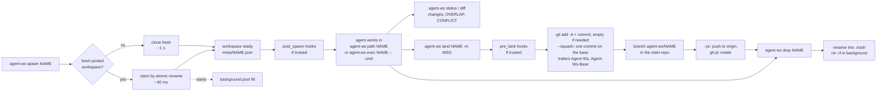
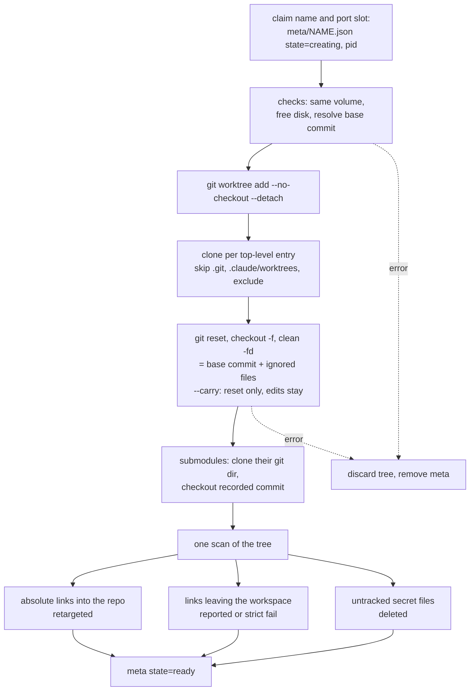
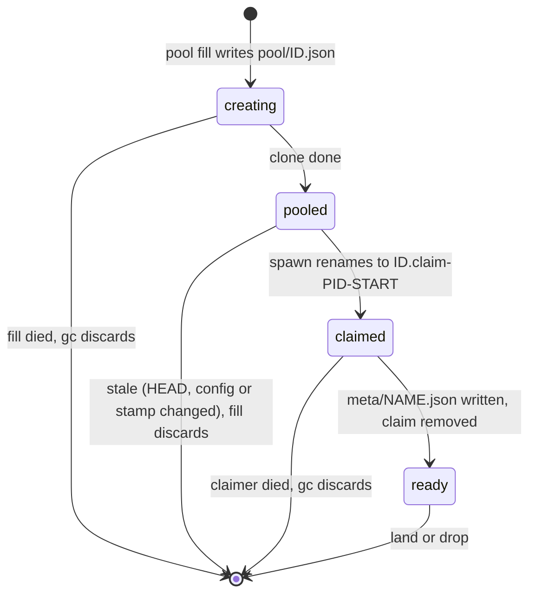
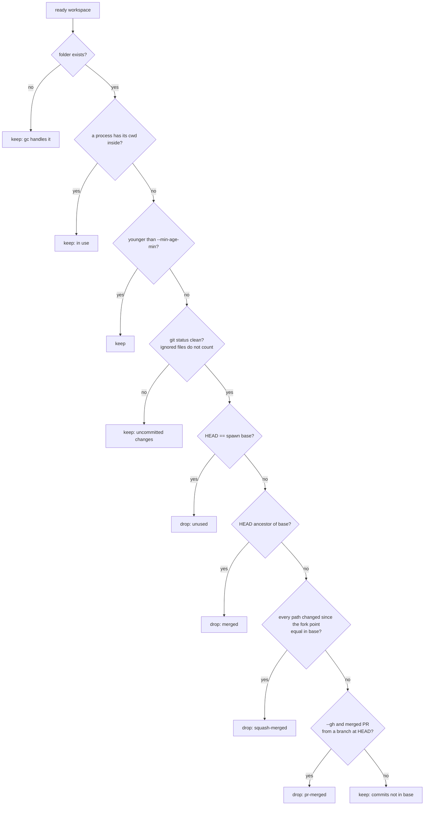

# How agent-ws works

This page is for people who want to understand or change agent-ws. To use it,
read the [README](../README.md).

## Lifecycle of one workspace



## What a fresh clone does



`clonefile(2)` on a directory clones the whole tree in one system call. Data
blocks are shared copy-on-write, so a clone costs metadata only; a file is
copied block by block only when something writes to it.

Linux has no directory clone. There agent-ws recreates each directory and
reflinks every file with the `FICLONE` ioctl, which shares data blocks the
same way on Btrfs and on XFS (`reflink=1`, the default since xfsprogs 5.1).
Modes and timestamps are kept, so build tools see unchanged files. It takes
a few system calls per file instead of one per tree, so a fresh clone is
slower than on macOS; the pool hides that. On a filesystem without reflinks
(ext4) the spawn fails with a message saying so: a full copy would defeat
the purpose.

After the scan, `--branch` creates and checks out a branch at the base, then
the trusted `post_spawn` hooks run. If either fails, the workspace is
dropped again, so a spawn either fully happens or leaves nothing.

## What a workspace contains

- Tracked files at the base commit (`--base`, default `HEAD`). Uncommitted
  edits and untracked files in the source checkout are not copied, unless
  `--carry` brings them: then the base must be `HEAD`, the clone keeps the
  working tree as it is (only the index is reset to `HEAD`), and the edits
  show up as uncommitted changes. Submodules keep their state too. Secrets
  still stay behind without `--keep-secrets`, and the pool is not used.
- Ignored files from the source checkout (dependencies, caches, build output).
- Not `.git` (the worktree links to the shared object store) and not
  `.claude/worktrees`. More paths can be skipped with `--exclude` or the
  `exclude` setting.
- Not untracked secret files, wherever they are (also inside ignored
  folders): `.env`, `.env.*`, `.dev.vars`, `*.pem`, `*.key`, `*.p12`,
  `id_rsa`, `id_ed25519`, except `.env.example`, `.env.sample` and
  `.env.template`. Tracked files are never removed. Files holding only PEM
  certificates (no key), such as certifi's `cacert.pem` CA bundle in a
  Python `.venv`, are public and stay. `--keep-secrets` keeps them,
  including untracked secrets that are not ignored; other untracked files
  are still left out.
- Checked-out submodules with their own copy of the submodule's git dir, at
  the commit the base records. Commits made inside a submodule stay in the
  workspace; `land` records the new submodule commit in the parent.

## Pool

Pooled workspaces are ordinary fresh clones registered under `pool/` instead
of `meta/`. A spawn takes one by renaming its record (atomic, so of several
racing spawns exactly one wins), then writes the named record.



A pooled workspace is used only while its freshness key matches: `HEAD`, the
settings that shape a workspace, and the size and mtime of the stamp files
(lockfiles, `node_modules/.modules.yaml` …). Edits to other ignored files are
not detected, so a pooled workspace can carry slightly older dependencies if
they changed without touching a stamp file. Only one `pool fill` runs at a
time (`flock`).

The first build in any new workspace reads files cold: macOS caches file
contents per file, not per shared disk block.

## Ports and exec

Every named workspace gets a port slot when it is spawned: the lowest number
no other record holds, chosen under `slots.lock` so parallel spawns differ.
Dropping the workspace frees the slot. Commands that `exec` and the hooks
run get:

| Variable | Value |
| --- | --- |
| `AGENT_WS_NAME`, `AGENT_WS_PATH`, `AGENT_WS_BASE`, `AGENT_WS_REPO` | the workspace and its repository |
| `AGENT_WS_SLOT` | the slot |
| `PORT`, `AGENT_WS_PORT` | `port_base + slot * port_step`, by default 4100, 4110, 4120 … |

The default range stays clear of the usual dev server ports (3000, 4321,
5173, 8787); each workspace owns `port_step` ports from its `PORT` on.

`exec` starts the command in the workspace, then ignores Ctrl-C itself so
that it outlives the command: the signal still reaches the command, and
agent-ws records how it ended in `runs/<name>.json` (command, pid, start
time, end time, exit code; 128 + the signal for a killed command). `list
--long` reads that record: `running` while the pid with that start time
lives, `exited`, or `interrupted` when agent-ws itself was killed first.
The exit code of `agent-ws exec` is the command's.

## Reviewing work: diff and conflicts

`diff` and the conflict check need the workspace's current state as a tree,
uncommitted edits and new files included, without disturbing an agent that
may be committing at that moment. agent-ws copies the workspace's index to
`tmp/`, runs `git add -A` and `git write-tree` with `GIT_INDEX_FILE` pointing
at the copy, and deletes the copy. The copy keeps the cached file stats, so
only changed files are read again; Git writes an index by rename, so the
copy is never half-written. `diff` then compares the base with that tree.

`status` lists paths changed in more than one workspace as `OVERLAP`. Many
overlaps merge cleanly (different lines of one file), so for each pair of
overlapping workspaces it also merges their snapshots in memory with `git
merge-tree --write-tree` (Git 2.38+). Each snapshot becomes a commit on the
workspace's HEAD, so Git finds the merge base. Pairs that do not merge
cleanly are listed as `CONFLICT` with their paths. These commits use a fixed
author and date: the same content gives the same objects, so polling
`status` adds nothing to the repository once nothing changes.

## Hooks and trust

`[hooks]` in `.agent-ws.toml` holds shell commands: `post_spawn` runs in a new
workspace (pooled ones too), `pre_land` before `land` commits. They run with
the environment above, and their output goes to stderr, so `--json` output
and the path printed for Claude Code stay clean.

`.agent-ws.toml` comes with the repository, so a fresh clone could otherwise
make `spawn` run any command. Hooks run only after `agent-ws trust`, which
stores the exact set of commands in `trusted-hooks.json` in the repository's
state folder; any change to them needs `trust` again. A spawn or land that
would run untrusted hooks stops and lists them. `spawn --no-hooks` and `land
--no-verify` skip them.

## Claude Code worktrees

Claude Code creates a git worktree for `claude --worktree`, for subagents
with `isolation: "worktree"`, for workflows and for background sessions. Its
`WorktreeCreate` and `WorktreeRemove` hooks replace that, and `agent-ws claude
install` registers `agent-ws claude hook` for both in a settings file
(`.claude/settings.local.json` by default), keeping everything else in the
file, key order included.

- `WorktreeCreate` reads Claude's JSON on stdin and spawns a workspace named
  after the worktree (`-2`, `-3` … when taken), from the pool when one is
  ready, on a new branch `agent-ws/<name>`, with `origin: claude` in its
  record. It prints the path and nothing else on stdout; warnings and hook
  output go to stderr.
- Commits the session makes land on that branch, which outlives the
  workspace like the branch of a git worktree. `WorktreeRemove` drops the
  workspace; the branch stays if it has commits and is deleted if it never
  moved. A path that is not an agent-ws workspace is refused and left alone;
  one that is already gone counts as removed.
- Claude Code never removes the worktree of a subagent or workflow agent. The
  background prune therefore also drops unused Claude workspaces, once they
  are a day old and no process sits in them.

## Safety

- Writes in a workspace never change the source checkout (copy-on-write).
- Absolute symlinks into the source are retargeted into the workspace.
  Relative symlinks that climb out of the repository are rewritten to the
  absolute path they meant in the source. Both kinds of links that leave the
  workspace are reported, and fail the spawn with `strict_symlinks`.
- Records are plain JSON files, so nothing trusts them: a record whose path is
  not exactly `<home>/<repo>/ws/<name>` is corrupt and is never renamed,
  deleted or used for git commands; `gc` forgets it without touching the
  path. Every removal goes through one function that checks this.
- `land` always adds a commit carrying the message and the `Agent-Ws`
  trailers (empty if the agent already committed everything). It refuses an
  existing branch unless the branch is already at the workspace's HEAD (an
  interrupted land) or was landed earlier by the same workspace (`--keep`),
  which then moves forward. The branch name is checked before anything is
  committed, and `spawn` refuses names that cannot be part of the branch
  `agent-ws/NAME` (`..`, a trailing `.` or `.lock`). Changed files count
  every path touched: a rename is two, so deleting a file another workspace
  edits is an overlap. A workspace Git cannot read is left out of `land`'s
  overlap check instead of failing it. A workspace on its own branch
  (`spawn --branch`, Claude Code) commits on that branch.
- `land --pr` pushes the branch and opens or finds the pull request before
  the workspace is dropped. If either fails, the workspace stays and running
  the same command again resumes at the landed commit.
- `status`, `prune` and `gc` read workspaces with `git --no-optional-locks`,
  so a coordinator polling them never takes the `index.lock` an agent needs
  to commit.
- `drop` renames the tree into `.trash` and deletes it with a background
  `rm -rf` in its own process group, so closing the terminal does not stop
  it. Each `drop` restarts deletes older than 10 minutes.
- Spawning stops below 2 GB of free disk (configurable) and warns below
  10 GB or from 20 workspaces (`warn_workspaces`).
- The pool holds at most 8 workspaces.

## Disk use and prune

A cloned block belongs to every file that shares it, so `du` counts it once
per workspace. `agent-ws du` asks the filesystem instead. On APFS,
`getattrlist` with `ATTR_CMNEXT_PRIVATESIZE` gives the bytes of a file that
no other file shares, which is what deleting it frees. On Linux, the `FIEMAP`
ioctl lists a file's extents and flags the shared ones; the rest is private.
Workspaces are walked in parallel,
one thread per core. Data not yet flushed has no blocks yet and counts later.
Blocks shared by two workspaces but no longer by the source are private to
neither, so the sum is a lower bound for a group.

`prune` checks each ready workspace, cheapest test first:



All checks are read-only (`git --no-optional-locks status`, `merge-base`,
`diff`), so `--dry-run` writes nothing, not even the index. A branch whose
upstream is gone is not enough on its own: a closed, unmerged PR deletes its
branch too. Dropping goes through `drop`.

The current directories come from `proc_pidinfo(PROC_PIDVNODEPATHINFO)` on
macOS and `/proc/<pid>/cwd` on Linux, for every process of the user. A
workspace on its own branch loses that branch with it when the branch is
merged or never moved.

## Many agents at once

- Spawn, land, drop and pool fills are safe in parallel. A spawn claims its
  name with an exclusive create before any work, so same-name spawns have
  exactly one winner. `git worktree add` and `git worktree prune` take
  turns (`flock` on `worktrees.lock`): `prune` deletes `.git/worktrees` once
  it is empty, and a parallel prune or add would then fail.
- Records of work in progress store the pid and the process start time.
  `gc` removes spawns, pool fills and pool claims whose process died
  (a later process that got the same pid does not count as alive), records of
  folders deleted by hand, folders with no record, and trash older than
  10 minutes. It never touches work whose process is still alive.
- A folder with no record is deleted only if it holds no work. With
  uncommitted changes, or a HEAD that no branch, remote branch or tag
  contains, it gets a new record (base: its fork point with the prune base).
  A folder Git cannot read is left alone, except an empty one.
- After each `spawn` a detached `prune --merged-only` runs, at most every
  10 minutes (`auto-prune.stamp`), unless `auto_prune = false`. It applies
  the same checks as `prune` but keeps `unused` workspaces, except Claude
  Code's after a day.
- A process start time tells a live owner from a later process with the same
  pid: microseconds since the epoch on macOS, clock ticks since boot (field
  22 of `/proc/<pid>/stat`) on Linux, only ever compared on one machine.

## Storage

State and workspaces live in `~/.agent-ws/<repo>-<hash>/`:

```
meta/<name>.json         named workspaces
pool/<id>.json           pooled workspaces (id = @pool-<nanos>)
ws/<name or id>/         the workspace trees (Git worktrees)
runs/<name>.json         the last `exec` in each workspace
runs/<name>.log          its output, with `exec --log` (default without a terminal)
repo.json                where the checkout is, for `agent-ws repos` and the app
tmp/                     index copies for snapshots, deleted after use
.trash/                  trees being deleted in the background
pool.json, pool.lock     pool target and fill lock
slots.lock               port slot assignment
worktrees.lock           git worktree add and prune take turns
trusted-hooks.json       the hooks `agent-ws trust` approved
auto-prune.stamp         when the background prune last ran
```

`AGENT_WS_HOME` overrides `~/.agent-ws`; it must be on the same volume as the
repository (APFS, Btrfs or XFS). On macOS the folder is excluded from
Spotlight and Time Machine. `gc` also removes run records of dropped
workspaces and index copies a killed process left in `tmp/`.

## Code map

| File | Role |
| --- | --- |
| `src/lib.rs` | `Repo`: spawn, claim, create/fill, pool, gc, prune, du, status, diff, exec, land, drop, hooks |
| `src/claude.rs` | Claude Code's WorktreeCreate/WorktreeRemove hook and its settings files |
| `src/fsutil.rs` | clones (`clonefile` on macOS, `FICLONE` on Linux), free space, private size, cwd users, the workspace scan, glob |
| `src/git.rs` | `git` CLI wrapper, changed-path listing, snapshots, merge-tree |
| `src/config.rs` | `.agent-ws.toml` |
| `src/main.rs` | thin CLI (clap), background refill, completions |
| `tests/cli.rs` | end-to-end tests on throwaway repositories |
| `bench/bench.sh` | benchmark against `git worktree` |
| `desktop/` | the desktop app (Tauri): a window and a menu-bar icon over the same library; see `desktop/README.md` |

All logic lives in the library so other tools can embed it.
